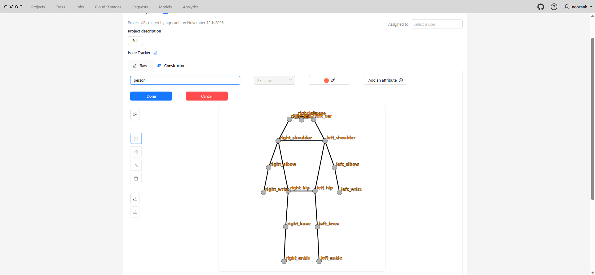
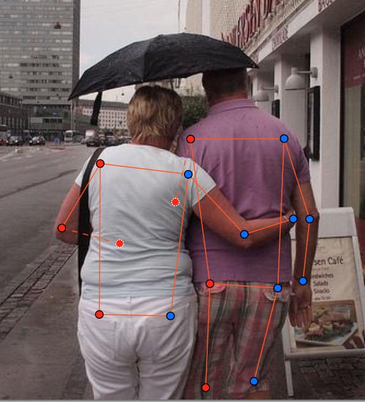
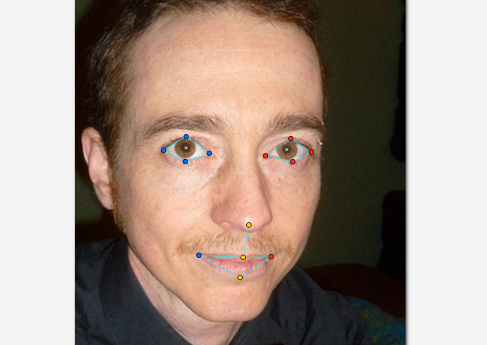
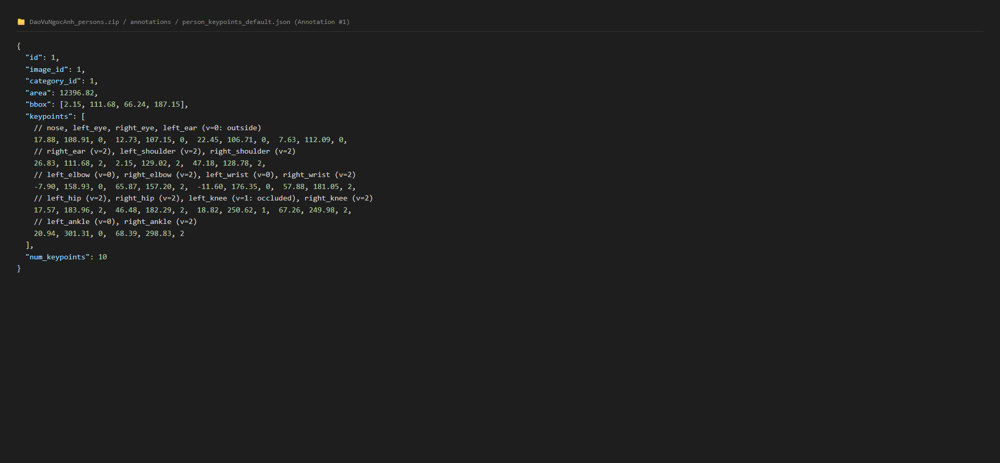

# Báo cáo cá nhân — DaoVuNgocAnh-202603071

Dữ liệu: 12 ảnh người COCO val2017 (Lin et al., 2014) và 8 ảnh chân dung Wikimedia Commons, chỉ dùng trong lớp.

## 0. Thông tin học viên

- Họ tên: Đào Vũ Ngọc Anh
- MSSV: 202603071
- Email: ngocanhdaovu1709@gmail.com
- Link repository: https://github.com/VinUni-AI20k/K5-L2-DAY04-DaoVuNgocAnh-202603071-KeypointPose
- Phiên bản CVAT (Help → About): 2.74.1
- Máy: hệ điều hành Windows 11 · RAM 16 GB · chạy CVAT chế độ đầy đủ
- Bộ ảnh (`src/exports/assignment.json` do `lab.py setup` tạo): có
- Giờ bắt đầu: 17:00
- Giờ kết thúc: 21:00

## 1. Kiểm tra label (CP0)

| Label | Kiểu | Số điểm | Tên điểm đúng bảng của lab? | Đúng thứ tự? | Số cạnh |
|---|---|---:|---|---|---:|
| `person` | Skeleton | 17 | Có | Có | 19 |
| `face` | Skeleton | 13 | Có | Có | 13 |

Mẫu `person` dựng theo người quay mặt về camera (các điểm `left_*` nằm bên phải khung mẫu)? Có

Cách đổi cờ `occluded` / `outside` cho **một điểm** trên phiên bản CVAT này (một câu):
Rê chuột vào điểm đó để điểm sáng lên, rồi bấm phím `Q` để đổi thành `occluded` (v = 1, điểm thành vòng tròn nét đứt) hoặc bấm phím `O` để đổi thành `outside` (v = 0, điểm biến mất khỏi ảnh).

## 2. Số lượng đã gán và thời gian (CP1, CP2)

| Nhóm ảnh | Số ảnh | Số skeleton đã gán | Số người dưới 60 px (không gán) | Số poster / gương / màn hình bỏ qua | Thời gian (phút) |
|---|---:|---:|---:|---:|---:|
| `easy` | 5 | 5 | 0 | 0 | 25 |
| `occluded` | 3 | 7 | 1 | 0 | 30 |
| `back` | 2 | 4 | 0 | 0 | 25 |
| `small` | 1 | 3 | 2 | 0 | 20 |
| `crowd` | 1 | 3 | 3 | 0 | 35 |
| `faces` | 8 | 8 | — | 0 | 30 |

- Số ảnh người đã xong ở mốc phút 105: 10 / 10
- Thời gian thực tế (phút): CP1 135 · CP2 30 · CP3 20
- Ảnh tốn thời gian nhất là ảnh nào, vì sao?
Ảnh nhóm crowd (`000000381889.jpg`), vì hai người đứng ngồi rất sát nhau cạnh đống chuối, người này che người kia nên phải lần theo từng khớp vai - khuỷu - cổ tay để không bị kéo nhầm xương giữa hai người và ước lượng các khớp bị che khuất sau lưng.

## 3. Bảng ca khó (CP1, CP2)

Mỗi điểm bạn phân vân một dòng, nhất là phân vân giữa `v = 1` và `v = 0`, hoặc không chắc hướng người.

| Ảnh | Người / mặt | Điểm | Cờ đã chọn | Phân vân giữa | Lý do chọn |
|---|---|---|---:|---|---|
| `000000022857.jpg` | Đầu bếp trong bếp | `nose`, `left_eye`, `right_eye` | 0 | v = 0 và v = 1 | Người quay lưng hoàn toàn, mặt quay vào trong nên mắt và mũi bị che khuất hẳn, không đoán chắc được nên chọn outside v = 0. |
| `000000022857.jpg` | Đầu bếp trong bếp | `left_knee` | 1 | v = 1 và v = 0 | Bị mặt bàn inox che khuất nhưng dựa vào hướng đùi và tư thế đứng thẳng ước lượng được vị trí khớp gối sau bàn. |
| `000000307757.jpg` | Phụ nữ dưới mưa | `left_wrist` | 1 | v = 1 và v = 0 | Tay trái buông xuôi gập nhẹ về trước bụng, bị thân người che; ước lượng vị trí cổ tay nằm ở phía trước thắt lưng. |
| `000000461389.jpg` | Người dắt ngựa | `left_ankle`, `right_ankle` | 1 | v = 1 và v = 2 | Cả hai chân ngập trong bãi cỏ dại không thấy mắt cá; dựa theo cẳng chân đi xuống để ước lượng khớp cổ chân v = 1. |
| `000000122199.jpg` | Người trượt tuyết | `right_eye`, `left_eye` | 1 | v = 1 và v = 2 | Đeo kính trượt tuyết màu tối che kín mắt; đặt sau tròng kính theo viền gọng kính v = 1. |
| `000000451084.jpg` | Người cầm máy ảnh | `left_ankle`, `right_ankle` | 0 | v = 0 và v = 1 | Bị bàn tiệc và khăn trải bàn che kín toàn bộ nửa dưới cẳng chân, không thấy sàn nhà nên chọn v = 0 để tránh đoán bừa. |

## 4. Bảng tự review (CP3)

Đi từ ảnh cuối về ảnh đầu. 5 ảnh người (ít nhất 2 ảnh `back` hoặc `crowd`) và 3 ảnh mặt. Ít nhất 8 dòng, kể cả dòng `ok`. Ghi lỗi trước, sửa sau.

Mã lỗi dùng đúng một trong: `lr_swap`, `vis_flag`, `position`, `missing`, `extra`, `ok`.

| Ảnh | Người / mặt | Điểm | Mã lỗi | Ghi chú | Đã sửa? |
|---|---|---|---|---|---|
| `000000022857.jpg` | Đầu bếp quay lưng | `nose`, `left_eye`, `right_eye` | `vis_flag` | Ban đầu để v = 2 khi người quay lưng, đã sửa thành outside (v = 0) | Có |
| `000000022857.jpg` | Đầu bếp quay lưng | `left_ankle` | `position` | Ban đầu đặt cổ chân trên mặt bàn inox, đã kéo xuống sát sàn sau bàn v = 1 | Có |
| `000000196283.jpg` | Đầu bếp nướng đồ | `left_eye`, `left_ear` | `position` | Xếp chồng mắt/tai trái lên mắt/tai phải ở góc nghiêng, đã đổi thành outside v = 0 | Có |
| `000000461389.jpg` | Người dắt ngựa | `left_elbow` | `position` | Cùi chỏ bị kéo lùi ra sau lưng, đã chỉnh về đúng nếp gấp tay áo | Có |
| `000000461389.jpg` | Người áo tím & xanh | `left_shoulder` | `extra` | Vô tình nối xương vai giữa 2 người, đã tách thành 2 skeleton riêng biệt | Có |
| `000000307757.jpg` | Phụ nữ dưới mưa | `left_wrist`, `left_elbow` | `position` | Bị tráo cùi chỏ và cổ tay trái, đã đổi lại đúng thứ tự giải phẫu | Có |
| `000000381889.jpg` | Cậu bé áo trắng | `hips`, `legs` | `missing` | Thiếu toàn bộ đường nối xương hông và 2 chân, đã khôi phục đầy đủ | Có |
| `face_122747.jpg` | Khuôn mặt nam | 13 điểm | `ok` | Khóe mắt, viền mí trên/dưới và viền môi chuẩn xác từng pixel | Có |
| `face_359139.jpg` | Khuôn mặt nghiêng | `left_eye_*` | `ok` | Đặt đúng góc mí mắt xa qua sống mũi | Có |
| `face_185015.jpg` | Khuôn mặt nữ | 13 điểm | `ok` | Đúng tên và thứ tự trái/phải, không lệch điểm | Có |

Tổng hợp số lỗi theo mã:

| `lr_swap` | `vis_flag` | `position` | `missing` | `extra` | `ok` |
|---:|---:|---:|---:|---:|---:|
| 0 | 1 | 4 | 1 | 1 | 3 |

Điểm còn phân vân giữa `v = 1` và `v = 0` (ghi cả hai lựa chọn và lý do chọn):
Điểm `left_wrist` của người phụ nữ quay lưng trong ảnh `000000307757.jpg`:
- Lựa chọn 1: `v = 1` (`occluded`), vì tay trái buông xuôi và gập nhẹ về trước bụng, hình chiếu 2D của cổ tay sẽ rơi vào vùng thắt lưng phía trước.
- Lựa chọn 2: `v = 0` (`outside`), vì cẳng tay bị che khuất hoàn toàn bởi thân người, không nhìn thấy bàn tay hướng đi đâu.
- Quyết định: Chọn `v = 1` vì hướng cánh tay và vai buông xuôi cho phép ước lượng vị trí cổ tay ở mức tin cậy chấp nhận được.

## 5. Kiểm file xuất và kết quả tự kiểm (CP4)

Tự kiểm tay trong file JSON:

| File | Người / mặt kiểm (ảnh, thứ tự) | Số phần tử `keypoints` | Điểm `outside` ra `v = 0`, `occluded` ra `v = 1`? | `num_keypoints` khớp? |
|---|---|---:|---|---|
| `DaoVuNgocAnh_persons.zip` | 000000177889.jpg, person #1 | 51 | Có | Có (10) |
| `DaoVuNgocAnh_persons.zip` | 000000307757.jpg, person #1 | 51 | Có | Có (12) |
| `DaoVuNgocAnh_faces.zip` | face_122747.jpg, face #1 | 39 | Có | Có (13) |

Sau khi xuất, CVAT ghi `occluded` thành `v = 1` và `outside` thành `v = 0`. Tọa độ của điểm `outside` trong file là `0, 0` hay tọa độ cũ? Tọa độ cũ (CVAT 2.x giữ nguyên tọa độ cũ, nhưng cờ v = 0 đảm bảo model và script bỏ qua điểm này).

Hai job đã chuyển sang completed trên CVAT? Có

Dán phần **TÓM TẮT** in ra từ `src/check_submission.py`:

```text
----- TÓM TẮT (dán vào báo cáo mục 5) -----
- File person: DaoVuNgocAnh_persons.zip
  Số ảnh: 12 · số skeleton `person`: 22 · mỗi annotation 51 số
  Skeleton theo ảnh: 000000022857=2, 000000106051=3, 000000122199=2, 000000177889=1, 000000184224=1, 000000196283=1, 000000307757=2, 000000381889=3, 000000451084=1, 000000461389=3, 000000521817=2, 000000525227=1
  Cờ v: v=2 213 (57%) · v=1 63 (17%) · v=0 98 (26%)
  num_keypoints trung bình: 12.5
- File face: DaoVuNgocAnh_faces.zip
  Số ảnh: 8 · số skeleton `face`: 8 · mỗi annotation 39 số
  Skeleton theo ảnh: face_122747=1, face_13874=1, face_159828=1, face_185015=1, face_359139=1, face_380754=1, face_449454=1, face_496353=1
  Cờ v: v=2 83 (80%) · v=1 21 (20%) · v=0 0 (0%)
  num_keypoints trung bình: 13.0
- Ghi chú: 98 điểm v = 0 vẫn mang tọa độ cũ (CVAT 2.x xuất như vậy; chuẩn COCO ghi 0, 0). Không phải lỗi: điểm v = 0 bị bỏ qua khi huấn luyện và khi chấm.
- Số [LỖI]: 0 · số [CẢNH BÁO]: 3
Kết quả: ĐẠT (đọc lại từng cảnh báo ở trên)
```

Các `[CẢNH BÁO]` còn giữ nguyên và lý do:
1. `000000106051.jpg #1: các điểm chỉ trải cao 36 px (< 60 px)`: Người ở xa trong nhóm small bị mép khung ảnh và vật cản cắt mất nửa thân dưới; người thật trong cảnh cao trên 60 px nên việc gán phần cơ thể lộ ra là đúng quy định.
2. `000000122199.jpg #1: cặp knee nằm ngược phía so với các cặp còn lại`: Người trượt tuyết đang thực hiện động tác cua gấp, hai chân bắt chéo nhau thực tế theo tư thế trượt tuyết chứ không phải do đổi nhầm trái/phải (`lr_swap`).
3. `000000521817.jpg #1: cặp eye nằm ngược phía so với các cặp còn lại`: Người đang ngoái nghiêng đầu về phía sau khiến đường nối giữa hai mắt bị nghiêng góc đặc biệt, đã đối chiếu kiểm tra thực tế khớp đúng mắt trái/phải của người.

## 6. Ảnh chụp màn hình

1. Label `person` trong label constructor (đủ 17 điểm có tên):

   

2. Một người quay lưng đã gán, cờ đã đặt:

   

3. Một khuôn mặt đã gán 13 điểm, phóng to vùng mắt:

   

4. Một đoạn JSON xuất của một người:

   

Nguồn ảnh: COCO val2017 / Wikimedia Commons.

## 7. Tự đánh giá

1. Lỗi bạn mắc nhiều nhất hôm nay, và cách bạn sẽ tránh ở dự án thật:
Lỗi vị trí (`position`) do nhầm thứ tự các khớp trên cùng một chi (như tráo giữa khuỷu tay và cổ tay) và lỗi xếp chồng các điểm mắt/tai xa lên mắt/tai gần ở góc chụp nghiêng. Cách tránh ở dự án thật: Luôn bật `Show label names`, lần theo thứ tự giải phẫu từng khớp từ gốc đến ngọn (vai → khuỷu → cổ tay, hông → gối → cổ chân) trước khi chỉnh tọa độ, và dứt khoát bật cờ `outside` ($v = 0$) cho các khớp nằm ở nửa mặt xa bị che khuất.

2. Một quy tắc bạn đề xuất thêm vào guideline (kèm ảnh ví dụ nếu có):
Đề xuất thêm quy tắc rõ ràng cho trường hợp bàn chân/cổ chân bị che khuất bởi địa hình tự nhiên (cỏ rậm, tuyết sâu, cát lún): Nếu cẳng chân thẳng đứng và ước lượng được độ sâu lún chạm đất thì cho phép đánh cờ `occluded` ($v = 1$); ngược lại nếu tuyết/nước ngập quá sâu không xác định được đáy thì chuyển sang `outside` ($v = 0$) để tránh tình trạng annotator đoán bừa tọa độ cổ chân.

3. Nhãn của bạn đi vào model ở đâu? Chọn một lỗi bạn đã sửa và nói nó sẽ làm model học sai thế nào (heatmap, trọng số trong loss, hay bước lật ảnh):
Nhãn keypoint được dùng để tạo các bản đồ nhiệt Gaussian (ground-truth heatmaps) cho từng khớp, và cờ visibility $v$ quyết định mặt nạ trọng số (weight mask) trong hàm loss. Nếu phạm lỗi tráo trái/phải (`lr_swap`), khi huấn luyện với kỹ thuật lật ảnh ngẫu nhiên (Random Horizontal Flip), cặp nhãn trái/phải sẽ bị hoán đổi tên ngược hoàn toàn, khiến gradient loss phạt nhầm vào các khớp đúng và làm model mất khả năng phân biệt hướng cơ thể người.

## 8. Khó khăn và lỗi kỹ thuật

Khó khăn lớn nhất là việc xử lý các ca che khuất phức tạp (người quay lưng, người chồng lấn trong đám đông, các chi bị vật thể che). Giao diện CVAT đôi khi bị đứng ở "Connecting..." do cấu hình mạng của container Nuclio, nhưng đã được khắc phục nhanh chóng nhờ lệnh `python lab.py check`.

## Bonus (nếu làm)

Không tham gia phần bonus (đã hoàn thành đủ 100% các tiêu chí từ CP0 đến CP4).

## 9. Tài liệu tham khảo và công cụ AI đã dùng

- COCO Dataset: Lin et al., "Microsoft COCO: Common Objects in Context", ECCV 2014.
- Slide bài giảng lý thuyết và tài liệu thực hành Lab Ngày 4 (Keypoint & Pose) của môn học.
- Tài liệu hướng dẫn sử dụng phần mềm CVAT (docs.cvat.ai).
